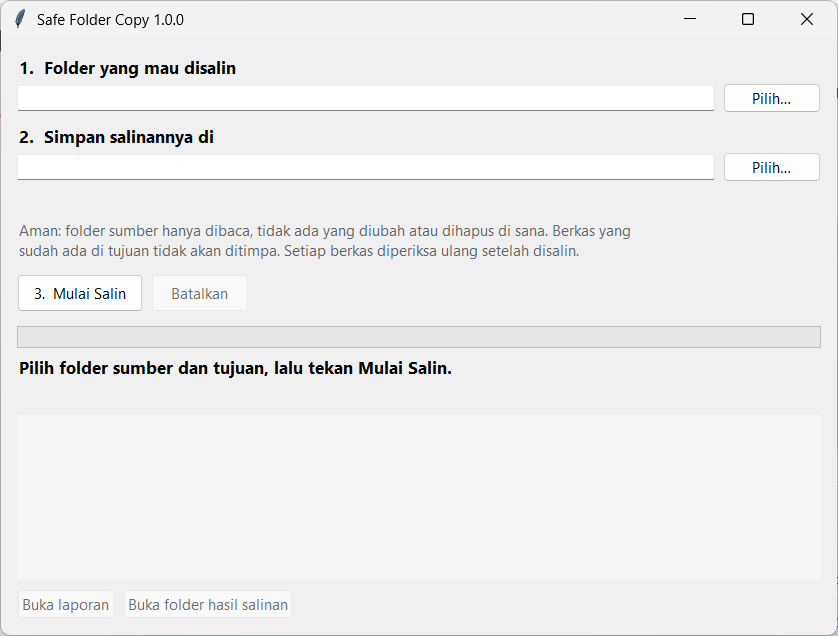

# Safe Folder Copy

**Copy a folder to another drive without getting stuck on damaged files.**
Salin folder ke drive lain tanpa macet gara-gara ada berkas yang rusak.



---

## Cara pakai (Bahasa Indonesia)

**1. Download satu berkas ini:**
**[SafeFolderCopy.exe](https://github.com/kelvianlab/Safe-Folder-Copy/releases/latest/download/SafeFolderCopy.exe)**

Tidak perlu instal apa pun, tidak perlu Python, tidak perlu mengetik perintah.

**2. Klik dua kali berkasnya.**
Saat pertama kali, Windows mungkin menampilkan *"Windows protected your PC"*. Itu karena
aplikasinya belum ditandatangani secara berbayar, bukan karena ada yang salah. Klik
**More info**, lalu **Run anyway**. Hanya diminta sekali.

**3. Ikuti nomor di layar:**
1. Pilih folder yang mau disalin.
2. Pilih tempat menyimpan salinannya. Di bawahnya langsung terlihat ke mana hasilnya nanti.
3. Tekan **Mulai Salin**.

Selesai. Kalau ada berkas yang tidak bisa disalin, namanya akan disebutkan di layar dan di
berkas laporan yang ikut tersimpan di folder tujuan.

### Yang dijamin

- **Folder asli tidak disentuh.** Hanya dibaca. Tidak ada yang diubah, dipindah, atau dihapus.
- **Tidak menimpa apa pun di tujuan.** Kalau di tujuan sudah ada berkas bernama sama dengan
  isi yang sama, dilewati. Kalau isinya berbeda, dibiarkan dan dilaporkan.
- **Setiap berkas diperiksa ulang** setelah disalin. Berkas baru dihitung "tersalin" kalau
  isinya terbukti sama persis dengan aslinya.
- **Tidak berhenti karena satu berkas rusak.** Dicoba ulang beberapa kali, lalu dicatat, dan
  penyalinan lanjut ke berkas berikutnya.
- **Bisa dilanjutkan.** Kalau dibatalkan atau laptop mati di tengah jalan, jalankan lagi dengan
  folder yang sama. Yang sudah tersalin dilewati otomatis.

### Yang tidak bisa dilakukan, terus terang saja

- **Berkas yang Windows sendiri tidak bisa baca tetap tidak bisa disalin.** Tidak ada aplikasi
  biasa yang bisa. Bedanya, aplikasi ini tidak ikut macet dan memberi tahu berkas mana saja.
- **Aplikasi ini menyalin, bukan memindah.** Hapus folder aslinya sendiri setelah memastikan
  laporannya bersih. Itu sengaja: memindah langsung pada drive yang bermasalah bisa
  menghilangkan data.
- Tanggal *diubah* ikut terbawa, tetapi tanggal *dibuat* menjadi tanggal saat disalin.

---

## English

### Why this exists

Copying a big folder with Windows Explorer can fail in a way that looks like nothing at all:
it sits on *"Preparing to copy"* while it counts every file first, and if one folder on the
drive is damaged, it never gets past that point. This tool was built after exactly that
happened on a 110,000-file folder whose filesystem had two corrupted directories.

Safe Folder Copy walks the folder once, then copies file by file. A file or folder it cannot
read is retried, written down, and skipped, and the copy carries on with everything else.

Measured on that same drive: a folder of 254 files (3.02 GB) containing the two corrupted
directories copied in 74 seconds. All 254 readable files arrived and matched their originals
byte for byte, checked again afterwards with Windows' own SHA-256 tool, and both damaged
directories were named in the report as unreadable. Three of those files ended up on paths
longer than Windows' old 260-character limit and were copied correctly anyway.

### What it guarantees

| Rule | How |
|---|---|
| The source is never changed | Source files are only ever opened for reading |
| Nothing at the destination is overwritten | An existing identical file is skipped; a different one is left alone and reported |
| A copied file is a verified file | Each file is written under a temporary name, read back, compared with the source by hash, and only then given its real name |
| One bad file never stops the run | A file that fails to read is tried three times in all, then listed by path with a plain-language reason |
| An interrupted run leaves nothing half-written | Temporary files are removed on cancel, failure, or full disk; rerunning resumes |
| Long paths work | Paths beyond 260 characters are handled |

A run also checks that the destination has room before copying anything, refuses a
destination inside the source, and does not follow folder shortcuts (junctions or symbolic
links), which can otherwise send a copy round in circles.

### What it cannot do

- It cannot read what Windows cannot read. Recovering data from a damaged folder is a job for
  dedicated recovery software, usually after making a copy of everything still readable.
- The read-back check reads through the operating system, which may answer from its cache.
  It proves what Windows stored, not what the physical disk will return years from now.
- File creation dates are not preserved. Modification dates are.

### The report

Every run writes `Laporan Safe-Folder-Copy <date time>.txt` into the destination folder. It
lists how many files were copied and verified, how many were already there, and, by name,
every file or folder that could not be read or copied, with the reason.

### Running from source

Python 3.10 or newer. There are no third-party dependencies. (People using the `.exe` do
not need Python at all.)

```bash
python -m safe_folder_copy
```

Copy without the window, for scripts. Here `DESTINATION` is the exact folder to copy into:

```bash
python -m safe_folder_copy --copy "D:\Data" "E:\Backup\Data"
```

Exit code `0` means everything was copied, `1` means some files were not, and `2` means the
run was refused or stopped (for example, not enough space).

### Tests

```bash
pip install pytest
python -m pytest
```

### License

[MIT](LICENSE)
